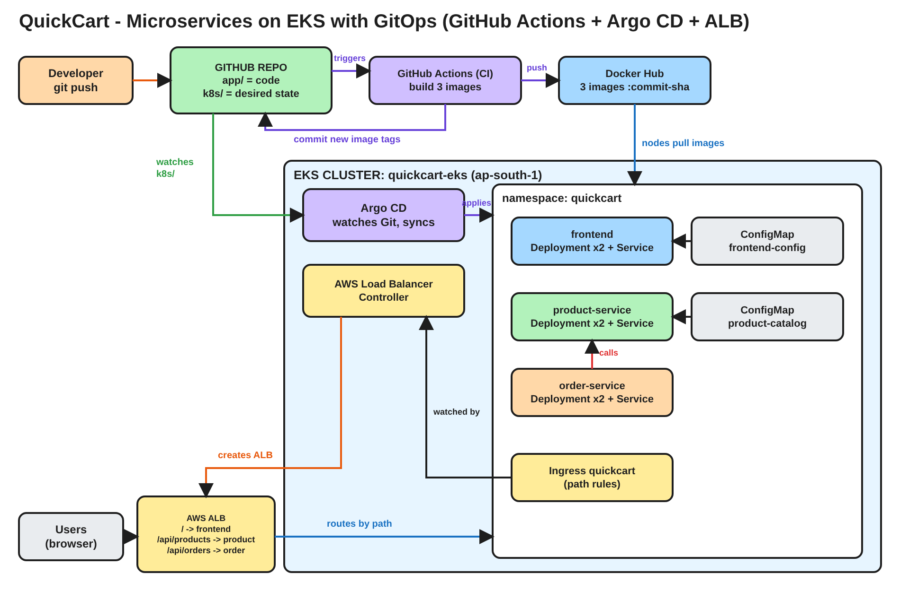

# QuickCart - Microservices on EKS with GitOps and Argo CD

**One lab. One application. From an empty AWS account to a self-healing, auto-deploying microservices shop.**
**Written by Rahul Chaubey**

---

## Before we start, one question

A developer changes one line of code and pushes it. Ten minutes later the change is live on a real AWS load balancer, in front of real users.

Nobody ran `kubectl`. Nobody logged in to the cluster. Nobody clicked "deploy".

How?

By the end of this lab you will have built exactly that, end to end, and you will be able to explain every piece of it.

---

## A note from me

I have written this lab so you can follow it on your own after class. Please do not just copy and paste. Before each step I tell you **why** we are doing it, and sometimes I ask you a question first. Try to answer it in your head before you read on.

There is only one lab. We start with an empty AWS account and finish with a working shop that deploys itself. Every Argo CD concept is explained at the exact moment you use it.

---

# PART A - Understand what we are building

## The application: QuickCart

QuickCart is a tiny online shop. You open it in a browser, you see products with prices, and you place an order. That is all it does, on purpose. Everyone already understands a shop, so all your attention can go to **how it is built and deployed**.



## Why microservices?

Real companies do not ship one big application. They split it into small services. Each service has its own code, its own container image and its own deployment, so teams can change one part without touching the others.

QuickCart has three microservices:

| Microservice | What it does | Technology | Port |
|---|---|---|---|
| frontend | The web page users see | nginx | 8080 |
| product-service | Lists products and prices | Python FastAPI | 8000 |
| order-service | Takes an order and asks product-service for the real price | Python FastAPI | 8000 |

## How one request travels

```text
 Browser
    |
    v
 AWS Application Load Balancer (ALB)  - one public URL
    |
    |-- /               ---> frontend         (the web page)
    |-- /api/products   ---> product-service  (the catalog)
    |-- /api/orders     ---> order-service  ---calls--->  product-service
```

**Think about it:** The browser only knows one URL. How does a request for the product list end up at product-service and not at the frontend?

**Answer:** The ALB reads the **path** of every request. Anything starting with `/api/products` goes to product-service, anything starting with `/api/orders` goes to order-service, and everything else goes to the frontend. This is called **path-based routing**.

When you click Order, order-service does not trust the price from the browser. It calls product-service **inside the cluster** to get the real price. That is **service-to-service communication**, and it happens through the Kubernetes Service name `http://product-service`.

## Everything Kubernetes will run

| Kubernetes object | How many | Names | Why |
|---|---|---|---|
| Namespace | 1 | quickcart | Keeps all QuickCart objects together |
| Deployment | 3 | frontend, product-service, order-service | Runs the pods, 2 replicas each |
| Service | 3 | frontend, product-service, order-service | A stable internal name and IP for each microservice |
| Ingress | 1 | quickcart | Tells AWS to create the ALB and its routing rules |
| ConfigMap | 2 | frontend-config, product-catalog | Shop banner and product prices, kept outside the code |

That is 10 objects, and all of them live in the `k8s/` folder of this repository.

## What is in this repository

```text
quickcart-gitops/
  app/
    frontend/              index.html + Dockerfile
    product-service/       main.py + Dockerfile
    order-service/         main.py + Dockerfile
  k8s/                     the 10 Kubernetes objects (what Argo CD deploys)
    00-namespace.yaml
    10-frontend.yaml       ConfigMap + Deployment + Service
    20-product-service.yaml ConfigMap + Deployment + Service
    30-order-service.yaml  Deployment + Service
    40-ingress.yaml        the ALB
  argocd/
    quickcart-app.yaml        the Argo CD Application, manual sync
    quickcart-app-auto.yaml   the same Application, fully automated
  cluster/
    eks-cluster.yaml       the EKS cluster definition
  .github/workflows/
    ci.yaml                the CI pipeline
  diagrams/                the architecture diagram
```

## The whole GitOps flow, in one picture

```text
  YOU                 GITHUB ACTIONS (CI)          GIT                  ARGO CD (CD)          EKS
  change code   --->  build 3 images        --->   k8s/*.yaml    <---   watches Git    --->   pods updated
  git push            push to Docker Hub           new image tags        applies changes       ALB serves it
                      commit new tags to Git
```

Two rules make this work, and you will see both in action:

1. **CI builds, CD deploys.** The pipeline never touches the cluster.
2. **Git is the single source of truth.** The cluster always ends up looking exactly like the `k8s/` folder.

## What you will be able to explain at the end

- How a microservices app is split into Deployments, Services, ConfigMaps and an Ingress
- How an ALB routes traffic by path, and why EKS needs the AWS Load Balancer Controller for it
- How a CI pipeline builds images and hands over to CD through Git
- What an Argo CD Application is, and what Synced and OutOfSync mean
- Manual sync, automated sync, self-heal and prune
- How a code change, a config change and a rollback all happen through Git only

---

# PART B - Build it, step by step

## Step 0 - Tools and accounts

You need these tools on your laptop:

| Tool | Check | Install on Windows (PowerShell) |
|---|---|---|
| git | `git --version` | `winget install -e --id Git.Git` |
| AWS CLI v2 | `aws --version` | `winget install -e --id Amazon.AWSCLI` |
| kubectl | `kubectl version --client` | `winget install -e --id Kubernetes.kubectl` |
| eksctl | `eksctl version` | see below |
| helm | `helm version` | `winget install -e --id Helm.Helm` |

On Windows, use **Git Bash** for every command in this lab. To install eksctl in Git Bash:

```bash
mkdir -p ~/bin && cd ~/bin
curl -sLO https://github.com/eksctl-io/eksctl/releases/latest/download/eksctl_Windows_amd64.zip
unzip -o eksctl_Windows_amd64.zip && rm eksctl_Windows_amd64.zip
echo 'export PATH="$HOME/bin:$PATH"' >> ~/.bashrc && source ~/.bashrc
cd ~
```

On macOS: `brew install git awscli kubectl eksctl helm`

You also need:

- An **AWS account** with an IAM user that has AdministratorAccess, configured with `aws configure` and region `ap-south-1`
- A **GitHub account**
- A **Docker Hub account**

Check AWS:

```bash
aws sts get-caller-identity
```

**Checkpoint:** every tool prints a version, and AWS shows your account.

**Concept: Set a budget alert first**
EKS, the nodes and the ALB all cost money every hour. In the AWS Console open **Budgets**, create a monthly cost budget, and add your email. It takes two minutes and protects you from a surprise bill.

---

## Step 1 - Get the code into your own GitHub repository

Open https://github.com/discover-devops/quickcart-gitops and click **Fork**. Keep the name `quickcart-gitops` and keep it **Public**.

**Think about it:** Why can you not just use my repository?

**Answer:** In GitOps, Git controls the cluster. You need to push changes and watch your cluster react. You cannot push to my repository, so you work on your own copy.

Clone your fork:

```bash
git clone https://github.com/<your-github-username>/quickcart-gitops.git
cd quickcart-gitops
```

Open `argocd/quickcart-app.yaml` and `argocd/quickcart-app-auto.yaml` in VS Code. In both files, change `discover-devops` in the `repoURL` line to **your** GitHub username. Save, then:

```bash
git add argocd/
git commit -m "point Argo CD at my fork"
git push origin main
```

From now on, run every command from inside the `quickcart-gitops` folder.

---

## Step 2 - Create the EKS cluster

```bash
eksctl create cluster -f cluster/eks-cluster.yaml
```

This takes about 20 minutes. Open `cluster/eks-cluster.yaml` and read it while you wait:

| Setting | Meaning |
|---|---|
| name: quickcart-eks | The cluster name |
| region: ap-south-1 | Mumbai |
| withOIDC: true | Lets Kubernetes service accounts use AWS IAM roles |
| serviceAccounts: aws-load-balancer-controller | An IAM role that is allowed to create ALBs, linked to a Kubernetes service account. We use it in Step 5 |
| 2 x t3.medium | Two worker nodes |

**Concept: One file, one command**
Behind this command, eksctl builds a VPC, subnets, IAM roles, the EKS control plane and the nodes through CloudFormation. Open **CloudFormation** in the AWS Console to watch it happen. Because the whole cluster is defined in a file, you can delete it after class and create the same cluster again next time.

**While the cluster is being created, do Step 3 and Step 4.** They do not need the cluster.

When eksctl finishes:

```bash
kubectl get nodes
```

**Checkpoint:** 2 nodes `Ready`.

---

## Step 3 - Read the code (while the cluster builds)

You will deploy this code, so spend five minutes understanding it.

**product-service** - open `app/product-service/main.py`

- `GET /api/products` returns all products, plus the service version and the pod name.
- `GET /api/products/{id}` returns one product. order-service calls this.
- `GET /api/products/health` is the health check for Kubernetes and the ALB.
- The products are **not in the code**. They are read from `/config/products.json`, a file that Kubernetes mounts from the `product-catalog` ConfigMap.

**order-service** - open `app/order-service/main.py`

- `POST /api/orders` takes a product id and a quantity, calls `http://product-service/api/products/{id}` for the real price, and returns a confirmation with the pod that handled it.

**frontend** - open `app/frontend/index.html`

- A plain web page that calls `/api/products` and `/api/orders`. It reads the shop name and banner from `config/config.json`, which comes from the `frontend-config` ConfigMap.
- The footer shows which version and which pod of each microservice answered. You will watch it change during the lab.

**Think about it:** Why is the product price in a ConfigMap and not in the code?

**Answer:** So that changing a price does not need a new image, a new build or a developer. Configuration and code change at different speeds, so we keep them apart. You will change a price through Git in Step 12.

Now look at the `k8s/` folder. Every Deployment, Service, ConfigMap and the Ingress from the table in Part A is there, with comments.

---

## Step 4 - CI: let GitHub Actions build the images

Kubernetes cannot run `main.py`. It can only run **container images** from a registry. Something has to build them. In real teams, that is a **CI pipeline**.

Open `.github/workflows/ci.yaml`. It has three jobs, and each one runs only if the previous one passed:

1. **test** runs the unit tests (`app/*/test_main.py`). If any test fails, the pipeline stops and nothing is built.
2. **build** builds the three images and pushes them to Docker Hub, tagged with the Git commit ID.
3. **update-manifests** writes those new tags into `k8s/*.yaml` and commits them back to Git.

**Think about it:** The pipeline needs to log in to Docker Hub. Where does the password come from? It is not in this file.

**Answer:** From **GitHub secrets**. You store them once in the repository settings. GitHub gives them to the pipeline at run time and hides them in every log.

### 4.1 Create a Docker Hub access token

1. Log in to https://hub.docker.com
2. Go to **Account settings**, then **Personal access tokens**, then **Generate new token**.
3. Description: `quickcart-ci`. Permissions: **Read & Write**. Click **Generate**.
4. Copy the token. You will see it only once.

### 4.2 Add two secrets to your GitHub repository

In your fork, go to **Settings**, then **Secrets and variables**, then **Actions**, and stay on the **Secrets** tab. Click **New repository secret** twice:

| Name | Value |
|---|---|
| DOCKERHUB_USERNAME | your Docker Hub username |
| DOCKERHUB_TOKEN | the token you just copied |

**Concept: Secrets are never copied to forks**
You forked my repository, but my secrets did not come with it. If GitHub copied secrets to forks, anyone could fork a repository and steal its passwords.

### 4.3 Run the pipeline

1. Open the **Actions** tab. In a fork, GitHub switches workflows off. Click **I understand my workflows, go ahead and enable them**.
2. Click **CI - build and release** in the left menu, then **Run workflow**, then the green **Run workflow** button.
3. Click into the run. Two `test` jobs run first, then three `build` jobs in parallel, then `update-manifests`.

It takes about 3 minutes.

**Checkpoint:**

- All jobs are green.
- Docker Hub shows three repositories: `quickcart-frontend`, `quickcart-product-service` and `quickcart-order-service`. Make sure each one is **Public**.
- Your repository has a new commit from `github-actions[bot]` called `ci: release images ...`.

Pull that commit and look at what the bot changed:

```bash
git pull origin main
git log --oneline -3
grep -n "image:" k8s/*.yaml
```

Every image line now points at **your** Docker Hub, with the commit ID as the tag.

**Concept: CI stops at Git**
Look at what the pipeline did **not** do. It has no kubeconfig and no AWS keys. It built images, pushed them, and changed one line per service in Git. That `image:` line is the handshake between CI and CD. Deploying is someone else's job.

---

## Step 5 - Install the AWS Load Balancer Controller

Wait until Step 2 has finished and `kubectl get nodes` shows 2 nodes `Ready`.

**Think about it:** Our `k8s/40-ingress.yaml` asks for an ALB. Kubernetes does not know anything about AWS. So who actually creates the ALB?

**Answer:** The **AWS Load Balancer Controller**. It runs inside the cluster, watches Ingress objects, and calls AWS to create and update ALBs. Without it, our Ingress would just sit there and nothing would happen. It needs AWS permissions, which is why eksctl created an IAM role for it in Step 2.

Check the service account that eksctl created:

```bash
kubectl get serviceaccount aws-load-balancer-controller -n kube-system -o yaml | grep role-arn
```

You see an IAM role ARN. That annotation is how the controller gets its AWS permissions, without any access keys.

Install the controller with Helm:

```bash
helm repo add eks https://aws.github.io/eks-charts
helm repo update eks

VPC_ID=$(aws eks describe-cluster --name quickcart-eks --region ap-south-1 \
  --query "cluster.resourcesVpcConfig.vpcId" --output text)
echo $VPC_ID

helm install aws-load-balancer-controller eks/aws-load-balancer-controller \
  -n kube-system \
  --set clusterName=quickcart-eks \
  --set serviceAccount.create=false \
  --set serviceAccount.name=aws-load-balancer-controller \
  --set region=ap-south-1 \
  --set vpcId=$VPC_ID
```

Wait for it:

```bash
kubectl rollout status deployment aws-load-balancer-controller -n kube-system
kubectl get ingressclass
```

**Checkpoint:** the controller shows `2/2` ready, and an IngressClass named `alb` exists.

---

## Step 6 - Install Argo CD

The images are ready and the cluster can make ALBs. Something still has to put our 10 objects into the cluster.

**Think about it:** Why not just add `kubectl apply -f k8s/` at the end of the CI pipeline?

**Answer:** Then GitHub would need the keys to your production cluster, and anyone who can edit the workflow could change production. And once the pipeline finishes, nobody watches the cluster. If someone changes something by hand, nobody notices.

GitOps does it the other way round. A tool runs **inside** the cluster, **pulls** from Git, and keeps the cluster matching Git, all the time. That tool is **Argo CD**.

```text
 Push model (old):    CI pipeline --kubectl apply--> cluster      (pipeline holds cluster keys)
 Pull model (GitOps): Git <--watches-- Argo CD (inside cluster)   (keys never leave the cluster)
```

Install it:

```bash
kubectl create namespace argocd
kubectl apply -n argocd --server-side --force-conflicts \
  -f https://raw.githubusercontent.com/argoproj/argo-cd/stable/manifests/install.yaml
kubectl wait --for=condition=Available deployment --all -n argocd --timeout=300s
kubectl get pods -n argocd
```

`--server-side` is needed because some Argo CD definitions are too large for a normal `kubectl apply`.

**Checkpoint:** all Argo CD pods are `Running`. Three of them matter today:

| Pod | Its job |
|---|---|
| argocd-repo-server | Reads your Git repository |
| argocd-application-controller | Compares Git with the cluster and fixes the difference |
| argocd-server | The UI you will log in to |

---

## Step 7 - Open the Argo CD UI

Open a **second** Git Bash window and keep this running:

```bash
kubectl port-forward svc/argocd-server -n argocd 8080:443
```

In your first window, get the admin password:

```bash
kubectl -n argocd get secret argocd-initial-admin-secret \
  -o jsonpath="{.data.password}" | base64 -d; echo
```

Open https://localhost:8080, accept the certificate warning, and log in as `admin`.

**Checkpoint:** an empty Applications page.

---

## Step 8 - Tell Argo CD what to deploy

Open `argocd/quickcart-app.yaml`. This is an Argo CD **Application**.

**Concept: An Application is a pointer**
It does not contain your app. It says: "the `k8s` folder of **this** Git repository, on the `main` branch, should be running in the `quickcart` namespace of **this** cluster." Nothing more.

Apply it:

```bash
kubectl apply -f argocd/quickcart-app.yaml
```

In the UI, the `quickcart` application appears as **OutOfSync** and **Missing**.

**Think about it:** Nothing failed and nothing was deployed. So why OutOfSync?

**Answer:** Argo CD always compares two things. The **desired state** is what Git says should exist. The **live state** is what is actually running. Git says 10 objects, the cluster has none. They disagree, and that is exactly what OutOfSync means.

The sync policy is **Manual**, so Argo CD shows you the difference and waits for your approval.

1. Click the `quickcart` application.
2. Click **DIFF** in the top bar to see every object Argo CD is about to create.
3. Click **SYNC**, then **SYNCHRONIZE**.

Watch the tree build itself: the Namespace, 2 ConfigMaps, 3 Deployments, 3 Services, the Ingress, then the pods.

```bash
kubectl get all,configmap,ingress -n quickcart
```

**Checkpoint:** 6 pods `Running` (2 per microservice), and the application is **Synced**. It may stay **Progressing** for 2 to 3 minutes while AWS creates the ALB.

---

## Step 9 - Open the shop

Get the ALB address:

```bash
kubectl get ingress quickcart -n quickcart
```

The `ADDRESS` column shows something like `quickcart-alb-123456789.ap-south-1.elb.amazonaws.com`. AWS needs 2 to 3 minutes before it answers, so wait a little, then open it in your browser with `http://`.

Look at the shop:

- The banner comes from the `frontend-config` ConfigMap.
- The products and prices come from the `product-catalog` ConfigMap.
- Choose a quantity and click **Order**. The confirmation shows which order-service pod handled it.
- The footer shows the version and pod of each microservice. Reload a few times and watch the product-service pod name change as the Service spreads requests across 2 pods.

Open the AWS Console, go to **EC2**, then **Load Balancers**, and open `quickcart-alb`. On the **Listeners** tab, open the rules: `/api/products*`, `/api/orders*` and the default rule to the frontend. Those are exactly the paths in `k8s/40-ingress.yaml`.

**Concept: Ingress to ALB**
You never clicked anything in the AWS Console. You wrote an Ingress, Argo CD applied it, and the Load Balancer Controller turned it into a real ALB with routing rules and health checks.

---

## Step 10 - Turn on automation

Clicking SYNC for every change does not scale. Open `argocd/quickcart-app-auto.yaml`. It is the same Application, with three switches turned on:

```yaml
  syncPolicy:
    automated:          # a change in Git is deployed automatically
      selfHeal: true    # a manual change in the cluster is put back to what Git says
      prune: true       # an object deleted from Git is deleted from the cluster
```

| Switch | It reacts to | What it does |
|---|---|---|
| automated | A change in **Git** | Syncs it without waiting for a click |
| selfHeal | A change in the **cluster** | Reverts it to match Git, within seconds |
| prune | A file **removed** from Git | Deletes that object from the cluster |

**Think about it:** Why is prune off unless you switch it on?

**Answer:** Deleting is dangerous. If someone deletes a file from Git by mistake, you do not want production to disappear automatically unless you have decided that is the behaviour you want.

Apply it:

```bash
kubectl apply -f argocd/quickcart-app-auto.yaml
```

In the UI, open the application and click **DETAILS**. The sync policy now shows **Automated** with self-heal and prune.

---

## Step 11 - Break it, and watch it heal

Open a **third** Git Bash window and watch the pods:

```bash
kubectl get pods -n quickcart -w
```

Now play the person who changes production by hand. Run these one at a time in your first window and watch Argo CD react.

**Break 1 - someone scales a service down:**

```bash
kubectl scale deployment product-service -n quickcart --replicas=1
```

Within a few seconds it is back to 2.

**Break 2 - someone deletes a whole microservice:**

```bash
kubectl delete deployment order-service -n quickcart
```

It comes straight back.

**Break 3 - someone changes a price directly in the cluster:**

```bash
kubectl patch configmap product-catalog -n quickcart --type merge \
  -p '{"data":{"products.json":"[{\"id\":1,\"name\":\"Hacked Item\",\"price\":1}]"}}'
```

Check the ConfigMap after a few seconds:

```bash
kubectl get configmap product-catalog -n quickcart -o jsonpath='{.data.products\.json}'
```

The real catalog from Git is back.

Press Ctrl+C in the third window.

**Concept: Self-heal**
With self-heal on, Git is not just documentation. It is enforced. The only way to change production is to change Git. So how do you make an emergency fix? With a small, fast Git commit, never with kubectl.

---

## Step 12 - The full loop: change the code, push, and watch it deploy itself

This is the moment the whole lab has been building towards.

Open `app/product-service/main.py` and change the version:

```python
APP_VERSION = "1.1.0"
```

Also add a new product to the default list if you like. Then push:

```bash
git pull origin main
git add app/product-service/main.py
git commit -m "product-service: release 1.1.0"
git push origin main
```

Now just watch. Do not touch the cluster.

1. **GitHub, Actions tab:** the pipeline starts by itself, because you changed something under `app/`. It builds the three images with your new commit ID as the tag.
2. **GitHub, commits:** `github-actions[bot]` commits the new tags into `k8s/*.yaml`.
3. **Argo CD UI:** within 3 minutes Argo CD notices the new commit and syncs it on its own. Click **REFRESH** if you do not want to wait. Watch the new pods replace the old ones.
4. **Browser:** reload the shop. The footer shows **product-service v1.1.0**.

**Checkpoint:** product-service v1.1.0 is live, and you never ran a single kubectl command.

Now go back to the question at the top of this lab. How did a code change reach production without anyone touching the cluster?

**The developer pushed code. CI built an image and wrote its tag into Git. Argo CD, running inside the cluster, saw Git change and made the cluster match.** That one sentence is GitOps.

---

## Step 13 - Change a price without touching code

Not every change is a code change. Prices, banners and feature flags are **configuration**.

Open `k8s/20-product-service.yaml` and change the price of the Kubernetes Mug from `299` to `249`. Open `k8s/10-frontend.yaml` and change the banner to `"Big Diwali Sale - prices changed through Git"`. Then:

```bash
git add k8s/
git commit -m "config: mug price 249 and sale banner"
git push origin main
```

**Think about it:** Will the CI pipeline run this time?

**Answer:** No. The pipeline only runs when something under `app/` changes. Nothing needs to be built. Argo CD sees the changed ConfigMaps in Git and applies them directly.

Wait about a minute, because Kubernetes takes a moment to refresh a mounted ConfigMap file, then reload the shop. The new banner and the new price are live. No new image, no build, no restart.

---

## Step 14 - Roll back with Git

Say version 1.1.0 of product-service has a bug and you need 1.0.0 back right now.

**Think about it:** Do you need to rebuild the old image?

**Answer:** No. The old image is still on Docker Hub. You only need Git to point at it again. The bot's commit `ci: release images ...` is the deployment. Undo that commit, and you undo the deployment.

Find the bot's release commit for 1.1.0:

```bash
git pull origin main
git log --oneline -6
```

Copy the ID of the most recent `ci: release images ...` commit, then:

```bash
git revert --no-edit <commit-id>
git push origin main
```

Argo CD deploys the previous image tags. Reload the shop: the footer shows **product-service v1.0.0** again.

**Concept: git revert is the rollback button**
The history now has the release and the rollback, both with an author and a time. In the Argo CD UI, **HISTORY AND ROLLBACK** shows every sync against its Git commit. Your deployment history is your Git history.

Remember that the code in `app/` still says 1.1.0. Fix the bug in the code and push, and the pipeline releases a new, fixed version.

---

## What you built and what you learned

| Question | Your answer |
|---|---|
| How is QuickCart split? | 3 microservices, each with its own image, Deployment and Service |
| How does traffic reach the right service? | One ALB, path-based routing from the Ingress |
| Who creates the ALB? | The AWS Load Balancer Controller, from the Ingress |
| Who builds the images? | The CI pipeline, which pushes to Docker Hub and writes the tag into Git |
| Does CI touch the cluster? | Never |
| Who deploys? | Argo CD, from inside the cluster |
| What does OutOfSync mean? | Git and the cluster disagree |
| What do automated, selfHeal and prune do? | Deploy Git changes, revert manual changes, delete what was removed from Git |
| How do you change config? | Edit the ConfigMap in Git and push |
| How do you roll back? | `git revert` the release commit |

```text
 code change --> CI builds image --> tag committed to Git --> Argo CD syncs --> EKS --> ALB --> users
 config change ------------------> committed to Git -----> Argo CD syncs --> EKS --> ALB --> users
 manual kubectl change ----------------------------------> Argo CD reverts it
```

---

## Clean up - in this order

The ALB was created by the Load Balancer Controller, not by eksctl. If you delete the cluster first, the ALB and its security groups are left behind, keep costing money, and block the VPC from being deleted. So remove the app first.

**1. Delete the Argo CD Application.** Its finalizer deletes everything it deployed, including the Ingress, and the controller then deletes the ALB:

```bash
kubectl delete application quickcart -n argocd
```

**2. Wait until the ALB is gone.** Run this until it prints `[]`:

```bash
aws elbv2 describe-load-balancers --region ap-south-1 \
  --query "LoadBalancers[?LoadBalancerName=='quickcart-alb'].LoadBalancerName"
```

**3. Remove the controller, then delete the cluster:**

```bash
helm uninstall aws-load-balancer-controller -n kube-system
eksctl delete cluster -f cluster/eks-cluster.yaml
```

This takes about 10 minutes. Afterwards, check **CloudFormation** and **EC2 > Load Balancers** in the AWS Console. Nothing named `quickcart` should be left.

Next time, Steps 2, 5, 6, 7, 8 and 10 bring everything back. The application itself comes back from Git exactly as you left it.

---

## Troubleshooting

| What you see | Cause and fix |
|---|---|
| Pipeline fails at "Log in to Docker Hub" | Secret names are wrong or the token was copied incompletely. Check DOCKERHUB_USERNAME and DOCKERHUB_TOKEN |
| Pipeline fails at push with "denied" | The token is Read only. Create one with Read & Write |
| update-manifests fails at git push | Settings, Actions, General, Workflow permissions: choose **Read and write permissions** |
| No "Run workflow" button | Actions are not enabled in your fork yet. Open the Actions tab and enable them |
| Pods show ImagePullBackOff | The image does not exist or the Docker Hub repository is private. Run the pipeline and make the repositories Public |
| Argo CD says repository not found | `repoURL` in the argocd files still has my username or a typo, or your fork is private |
| Ingress ADDRESS stays empty | The Load Balancer Controller is not running. Check `kubectl logs -n kube-system deployment/aws-load-balancer-controller` |
| Controller logs show AccessDenied | Your eksctl is old and gave the controller an outdated IAM policy. Update eksctl to the latest version, delete and recreate the cluster |
| ALB address gives 503 | Targets are still registering. Wait 2 minutes. Check the target groups in the EC2 console |
| Browser cannot open the ALB address | AWS DNS is not ready yet. Wait 3 minutes. Use `http://`, not `https://` |
| New price does not show | A mounted ConfigMap can take up to a minute to refresh. Wait and reload |
| eksctl delete fails on the VPC | The ALB still exists. Do Clean up steps 1 and 2, then run eksctl delete again |

---

## Keep learning with me

If this lab helped you, there is a lot more where it came from.

| Where | Link |
|---|---|
| YouTube - Build Automate Architect | https://www.youtube.com/@BuildAutomateArchitect |
| System Design playlist | https://www.youtube.com/playlist?list=PLeAHTLMwFYQ0 |
| Telegram channel (lab updates and notes) | https://t.me/BuildAutomateArchitect |
| Website | https://rahulchaubeyconsulting.com/ |

Subscribe on YouTube and join the Telegram channel so you do not miss the next lab.

**Rahul Chaubey**
